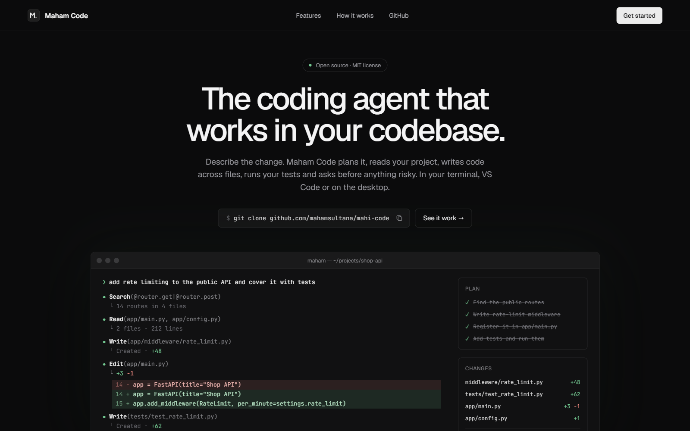
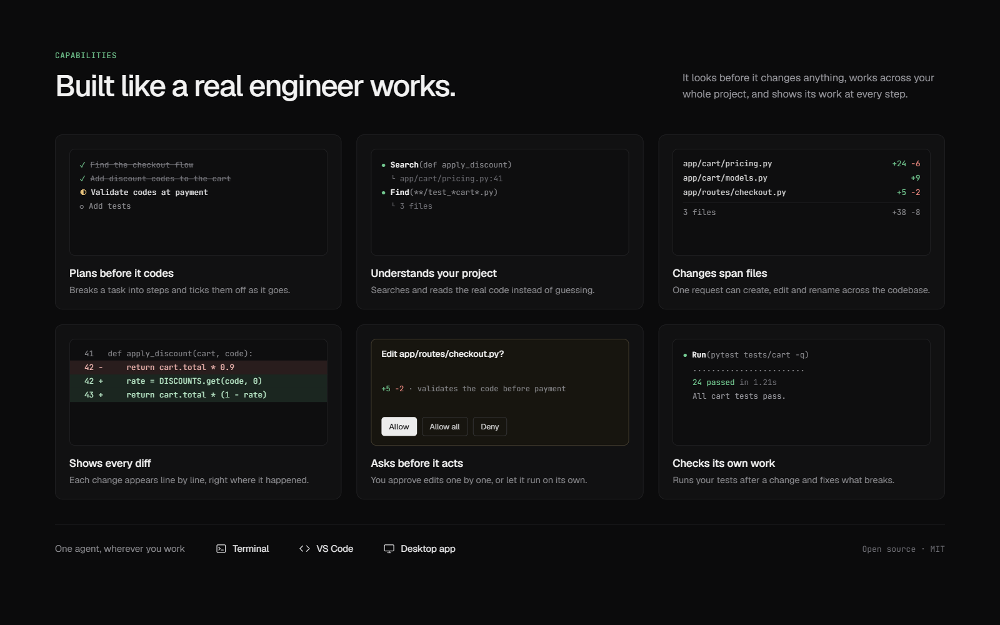
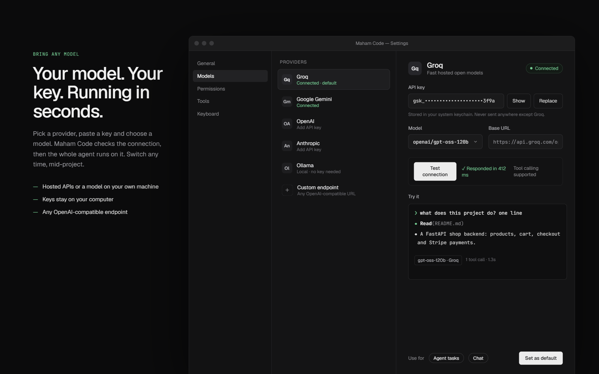

<p align="center">
  
</p>

# Maham Code

[](LICENSE)
[](https://www.python.org/)
[](#roadmap)

An open-source coding assistant built from scratch to learn how tools like Claude Code work under the hood.

It's being built in public, one milestone at a time. It already searches, reads, edits, creates and renames files in your project on its own; next it learns to ask before changing anything.

<p align="center">
  
</p>
<p align="center"><sub>Product design concept. See <a href="#roadmap">Roadmap</a> for what works today.</sub></p>

## One brain, three faces

All the AI logic lives in `core/`. Each app is a thin wrapper that just sends text in and shows text out.

```
                ┌──────────────┐
  Terminal ───► │              │
  Desktop  ───► │    core/     │ ───► LLM API
  VS Code  ───► │ (the brain)  │
   (via server) └──────────────┘
```

| Face | File | How it reaches the brain |
|---|---|---|
| Terminal | `cli/main.py` | Imports `core` directly |
| Desktop | `desktop/app.py` | pywebview window; JavaScript calls Python methods |
| VS Code | `vscode-extension/` | Sidebar chat that sends HTTP requests to `server.py` |

Upgrade the brain once and every face gets the upgrade.

## Quick start

You need Python 3.10+ and a free API key from [Groq](https://console.groq.com/keys).

```bash
git clone https://github.com/mahamsultana/mahi-code.git
cd mahi-code
pip install -r requirements.txt
cp .env.example .env      # then paste your key into .env
python -m cli.main        # on Windows: py -m cli.main
```

### Desktop app

```bash
python -m desktop.app
```

### VS Code extension

1. Start the server: `python server.py`
2. Open this folder in VS Code and press **F5**.
3. In the new window, click the **M** icon in the activity bar.

Highlight code, then right-click and choose **Ask Maham Code about selection**, to ask about it.

## Using a different model

Any OpenAI-compatible provider works. Change three lines in `.env`:

| Provider | Cost | `MAHAM_CODE_BASE_URL` |
|---|---|---|
| Groq (default) | Free tier | `https://api.groq.com/openai/v1` |
| Google Gemini | Free tier | `https://generativelanguage.googleapis.com/v1beta/openai/` |
| Ollama | Free, runs on your computer | `http://localhost:11434/v1` |

See `.env.example` for the matching model names.

## Roadmap

- [x] **Milestone 1:** Chat in the terminal, desktop and VS Code, with streaming replies and conversation memory
- [x] **Milestone 2:** Tools and the agent loop: the assistant explores, reads, edits, creates and renames files on its own
- [ ] **Milestone 3:** Approval prompts: you confirm before it changes a file
- [ ] **Milestone 4:** Running commands, with permission prompts

## Where it's headed

The designs below show where Maham Code is going: a plan it ticks off, diffs for every change, approval before edits, running your tests, and a settings screen for any model. Some of it works today (see the roadmap above); the rest is what the next milestones build.

<p align="center">
  
</p>

<p align="center">
  
</p>

Switching models already works today: change three lines in `.env` (see [Using a different model](#using-a-different-model)). The settings screen is planned.

## How it works

**Milestone 1: chat**

- **The `messages` list is the memory.** The API remembers nothing between calls, so the whole conversation is sent again every turn.
- **Streaming** shows the reply piece by piece instead of waiting for the full answer.
- **The faces contain no AI logic.** They only display strings.

**Milestone 2: tools and the agent loop**

- **Tools are described to the model, not given to it.** `core/tools.py` defines seven tools, modeled on Claude Code's, each with a JSON schema. The model can only *ask* for a tool call; Python decides whether to run it.

  | Tool | What it does |
  |---|---|
  | `list_files` | List one folder |
  | `find_files` | Find files by name pattern, like `**/*.py` |
  | `search_files` | Search inside files, returning `path:line: text` |
  | `read_file` | Read a file |
  | `edit_file` | Change part of a file in place by replacing exact text |
  | `write_file` | Create a file, or replace one completely |
  | `rename_file` | Rename or move a file or folder; never overwrites |

  There's no delete tool yet; that waits for approval prompts in Milestone 3.
- **The agent loop** lives in `Conversation.run()`. Each round, it sends the history plus the tool list. If the model asks for tools, Python runs them, adds the results to `messages` as `tool` messages, and asks again. When the model replies without asking for a tool, that reply is the answer. It stops after 10 rounds so a confused model can't loop forever.
- **Tools never crash the loop.** Errors come back as text, such as "file not found", so the model can read them and try something else.
- **Safety:** tools only touch files inside the folder you started from, and `.env` and `.git` are off limits. Whatever a tool returns is sent to your LLM provider.

You'll see each tool call as it happens:

```
you > what model does core/client.py use?
bot > [tool] Reading core/client.py

It defaults to openai/gpt-oss-120b, set by MAHAM_CODE_MODEL in .env.
```

## Project structure

```
mahi-code/
├── core/
│   ├── client.py        # Connects to the LLM provider
│   ├── chat.py          # Conversation class: memory, streaming, agent loop
│   └── tools.py         # The 7 file tools + safety checks
├── cli/main.py          # Terminal app
├── desktop/
│   ├── app.py           # Desktop window (pywebview)
│   └── index.html       # Desktop UI
├── server.py            # HTTP server the VS Code extension talks to
├── tests/               # Tool unit tests + live agent scenarios
└── vscode-extension/
    ├── extension.js     # Sidebar provider: bridge between VS Code and server.py
    └── media/           # Chat UI (main.js, main.css, icon.svg)
```

## Tests

```bash
python -m unittest discover tests     # tool tests: fast, no API key needed
python -m tests.agent_scenarios       # real conversations against the model (uses your quota)
```

The scenario tests run multi-turn conversations in a temporary folder, such as "create hello.py" followed by "rename the file to greet.py", then check the files on disk: the new file exists, the old one is gone, and nothing extra was created.

## Contributing

This is a learning project built in public, and ideas, issues and pull requests are welcome. See [CONTRIBUTING.md](CONTRIBUTING.md).

## License

MIT. See [LICENSE](LICENSE).
